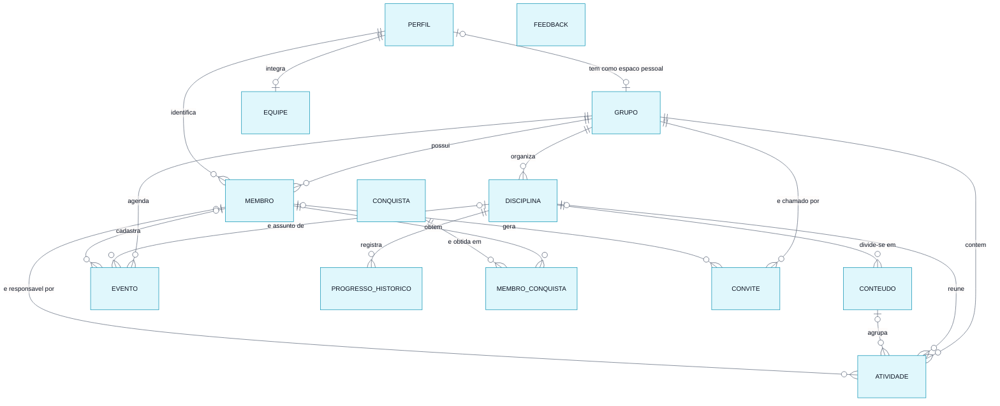

# Modelo Conceitual do Banco de Dados

> **Vértice** · Plataforma de Acompanhamento de Aprendizagem
> Entrega 2 · Modelagem do Banco de Dados · Equipe 7 · atualizado em 12/11/2026

---

O modelo conceitual identifica **o que** o sistema precisa guardar, sem decidir ainda como isso será implementado. As entidades foram extraídas dos substantivos que aparecem nos requisitos: grupo (RF01), membro (RF02), disciplina (RF13), conteúdo (RF14), atividade (RF03), evento (RF31), histórico de progresso (RF12), conquista (RF17), convite (RF28), perfil (RF35) e, desde 12/11, a resposta de feedback e a equipe do projeto (RF32). A conta de quem entra no sistema (RF27) fica no serviço de autenticação do Supabase, fora do modelo do domínio; o membro e o perfil apontam para ela.

---

## Diagrama entidade-relacionamento

> Versão em imagem para inserir no documento: [`modelo-conceitual.png`](modelo-conceitual.png)

---

## Entidades e atributos

| Entidade | Atributos | Origem |
|---|---|---|
| **GRUPO** | identificador, nome, descrição, foto do grupo, se é espaço pessoal, data de criação | RF01, RF29, RF34 |
| **PERFIL** | conta de acesso, nome, avatar e estilo do avatar, foto, lembrete por e-mail ligado, data do último lembrete, data de criação | RF35, RF36 |
| **MEMBRO** | identificador, conta de acesso, nome, função, e-mail, avatar e estilo do avatar, foto de perfil, perfil, data de criação | RF02, RF19, RF24, RF27 |
| **DISCIPLINA** | identificador, nome, cor de identificação, data de criação | RF13 |
| **CONTEUDO** | identificador, nome, descrição, ordem de apresentação | RF14 |
| **ATIVIDADE** | identificador, título, descrição, prazo, peso, prioridade, status, data de criação, data de conclusão | RF03, RN09, RF34 |
| **EVENTO** | identificador, título, tipo, data, data de fim, hora de início, hora de fim, local, descrição, data de criação | RF31, RN21 |
| **PROGRESSO_HISTORICO** | identificador, data do registro, percentual | RF12 |
| **CONQUISTA** | código, nome, descrição, ícone, tipo de critério, valor do critério | RF17 |
| **MEMBRO_CONQUISTA** | data de obtenção | RN12 |
| **CONVITE** | identificador, código, data de criação, data de vencimento, ativo | RF28, RN22 |
| **EQUIPE** | conta de acesso, data de criação | RF32, RN27 |
| **FEEDBACK** | identificador, nota, o que funcionou, o que travou, o que faltou, contato, origem, lida, data de envio | RF32, RN27 |

---

## Relacionamentos e cardinalidades

| Relacionamento | Cardinalidade | Leitura |
|---|---|---|
| GRUPO **possui** MEMBRO | 1 : N | Um grupo possui zero ou muitos membros; cada membro pertence a exatamente um grupo. O espaço pessoal tem um membro só, o dono (RN24) |
| PERFIL **identifica** MEMBRO | 1 : N, opcional | Um perfil identifica os membros da mesma conta, um em cada grupo, que levam o nome e a foto dele (RN26); o membro cadastrado pelo organizador e ainda sem conta não tem perfil. A ligação é pela conta de acesso, que os dois guardam |
| PERFIL **tem como espaço pessoal** GRUPO | 1 : 1, opcional | Cada perfil tem um espaço pessoal, criado no primeiro acesso, e cada espaço pessoal é de um perfil só (RN24) |
| GRUPO **organiza** DISCIPLINA | 1 : N | Um grupo organiza zero ou muitas disciplinas; cada disciplina pertence a exatamente um grupo |
| DISCIPLINA **divide-se em** CONTEUDO | 1 : N | Uma disciplina divide-se em zero ou muitos conteúdos; cada conteúdo pertence a exatamente uma disciplina |
| GRUPO **contém** ATIVIDADE | 1 : N | Um grupo contém zero ou muitas atividades; cada atividade pertence a exatamente um grupo, ou ao espaço pessoal de alguém |
| DISCIPLINA **reúne** ATIVIDADE | 1 : N, opcional | Uma disciplina reúne zero ou muitas atividades, do mesmo grupo dela; nos grupos, cada atividade pertence a exatamente uma disciplina, e no espaço pessoal, a nenhuma ou a uma (RN13, RN24) |
| CONTEUDO **agrupa** ATIVIDADE | 1 : N, opcional | Um conteúdo agrupa zero ou muitas atividades; cada atividade pertence a nenhum ou a um conteúdo, que precisa ser da mesma disciplina dela (RN13) |
| MEMBRO **é responsável por** ATIVIDADE | 1 : N, opcional | Um membro é responsável por zero ou muitas atividades; cada atividade tem um responsável ou fica "A definir", sem nenhum, até alguém assumir (RN06) |
| DISCIPLINA **registra** PROGRESSO_HISTORICO | 1 : N | Uma disciplina acumula zero ou muitos registros de progresso; cada registro pertence a uma única disciplina |
| GRUPO **agenda** EVENTO | 1 : N | Um grupo agenda zero ou muitos eventos; cada evento pertence a exatamente um grupo |
| DISCIPLINA **é assunto de** EVENTO | 1 : N, opcional | Um evento pode ser de uma disciplina (uma prova, por exemplo) ou de nenhuma (uma reunião); se a disciplina sai, o evento fica sem disciplina (RN02) |
| MEMBRO **cadastra** EVENTO | 1 : N, opcional | Cada evento guarda quem o cadastrou, para a regra de edição (RN21); eventos do exemplo e de membros removidos ficam sem autor |
| MEMBRO **obtém** CONQUISTA | N : N | Um membro obtém várias conquistas e uma conquista é obtida por vários membros |
| GRUPO **é chamado por** CONVITE | 1 : N | Um grupo tem zero ou muitos convites; cada convite leva a exatamente um grupo |
| MEMBRO **gera** CONVITE | 1 : N, opcional | Cada convite guarda o organizador que o gerou; se ele sai do grupo, o convite continua valendo até vencer |
| PERFIL **integra** EQUIPE | 1 : 1, opcional | A conta de quem faz o Vértice está na equipe e lê as respostas de feedback (RN27). A ligação é pela conta de acesso, como entre o perfil e o membro |

---

## Decisões do modelo

**Por que disciplina e conteúdo são entidades, e não campos da atividade.** Na versão anterior do sistema, "disciplina" era um texto digitado dentro da atividade. Com isso, "Banco de Dados" e "banco de dados" viravam duas disciplinas diferentes e não havia onde ancorar o progresso. Os requisitos RF10 e RF11 exigem um percentual por conteúdo e por disciplina, o que só é possível se ambos existirem como registros próprios com atividades vinculadas.

**Por que a atividade guarda a disciplina, e o conteúdo é opcional.** Até a revisão de 03/11, a atividade chegava à disciplina pelo conteúdo, e por isso todo grupo precisava criar ao menos um conteúdo antes da primeira atividade. Com o conteúdo opcional, a atividade passou a apontar direto para a disciplina; quando tem conteúdo, ele precisa ser da mesma disciplina (RN13), o que a aplicação valida e o banco reforça.

**Por que a atividade passou a guardar o grupo.** Até 11/11, o grupo de uma atividade era alcançado pelo caminho ATIVIDADE → DISCIPLINA → GRUPO, e guardar o grupo na atividade criaria um caminho alternativo que poderia divergir do primeiro. Com o espaço pessoal, a atividade pode não ter disciplina (uma tarefa do dia a dia), e o caminho deixou de existir para ela. A atividade passou a guardar o grupo, e a divergência é impedida pelo banco: quando há disciplina, ela precisa ser do mesmo grupo da atividade (RN24), e a atividade não muda de grupo depois de criada. As atividades existentes receberam o grupo da sua disciplina na atualização de 11/11.

**Por que o espaço pessoal é um grupo.** O espaço pessoal precisa de quase tudo o que o grupo já tem: atividades, eventos, disciplinas, as regras de acesso e o cálculo de progresso e de experiência. Modelá-lo como um grupo com a marca de pessoal, com um membro só, reaproveita toda essa estrutura, e as diferenças (disciplina opcional, sem convite, sem outros membros, não pode ser excluído) ficam em regras do banco, e não em tabelas novas.

**Por que o perfil é separado do membro.** O membro existe uma vez em cada grupo e guarda o que é do grupo: a função, o perfil de organizador ou participante e as atividades. O nome e a foto, que a pessoa quer iguais em todos os grupos (RN26), e a escolha do lembrete por e-mail são da conta, e não de um grupo. Guardá-los no membro obrigaria a pessoa a trocar a foto grupo por grupo, que era o comportamento até 11/11. O membro continua com as próprias colunas de nome e foto, que valem para quem ainda não tem conta e recebem uma cópia do perfil para quem tem.

**Por que o evento é separado da atividade.** A atividade é trabalho de alguém: tem responsável, peso, status e entra no progresso. O evento é algo que acontece num dia (uma prova, uma palestra) e não é concluído por ninguém. Juntar os dois obrigaria o evento a ter responsável e peso, e faria uma prova contar no progresso como se fosse tarefa.

**Por que existe MEMBRO_CONQUISTA.** O relacionamento entre membro e conquista é muitos-para-muitos e carrega um dado próprio: a data em que a conquista foi obtida. Esse dado não pertence nem ao membro nem à conquista, e sim ao encontro dos dois, o que exige a entidade associativa.

**Por que o progresso histórico é uma entidade.** O percentual atual de uma disciplina pode ser calculado a qualquer momento a partir das atividades. Já a evolução ao longo do tempo (RF12) não pode: não há como saber, olhando o estado de hoje, qual era o percentual há duas semanas. Por isso o valor diário precisa ser gravado.

**Por que a conta não é uma entidade do modelo.** Quem guarda o e-mail, a senha e o vínculo com o Google é o serviço de autenticação do Supabase, que tem as próprias tabelas. O modelo do Vértice só precisa saber qual membro é de qual conta, e por isso o membro ganhou o atributo "conta de acesso". Ele fica vazio enquanto a pessoa foi só cadastrada pelo organizador e ainda não entrou com a própria conta. Uma mesma conta pode ser membro de vários grupos, uma vez em cada.

**Por que o feedback não se liga a nada.** A resposta é anônima (RN27): ela não guarda a conta, o grupo nem o membro de quem respondeu, e por isso não tem relacionamento com as outras entidades. A origem diz só de onde veio (visitante, demonstração ou com conta), e o contato só existe se a pessoa quiser deixar.

**Por que a equipe é uma entidade.** Quem lê as respostas não é o organizador de um grupo, e sim quem faz o Vértice. Uma lista de contas guardada no banco deixa a regra de acesso conferir isso, sem depender de um e-mail escrito no código.

**Por que o convite é uma entidade.** O código precisa ser conferido quando alguém o usa, e ele vence: o banco precisa saber de que grupo é, quando foi criado e até quando vale (RN22).

**O que não virou entidade.** Experiência, ofensiva e percentual de progresso atual são valores derivados das atividades concluídas e das suas datas, calculados no momento da consulta. Não receberam entidade nem campo próprio para evitar uma segunda fonte de verdade, que precisaria ser corrigida a cada estorno previsto na RN10.

---

### Navegação

[⬅ Diagramas](../diagramas/04-atividade-cadastrar.md) · [Índice](../README.md) · [Próximo: Modelo Lógico ➡](02-modelo-logico.md)
