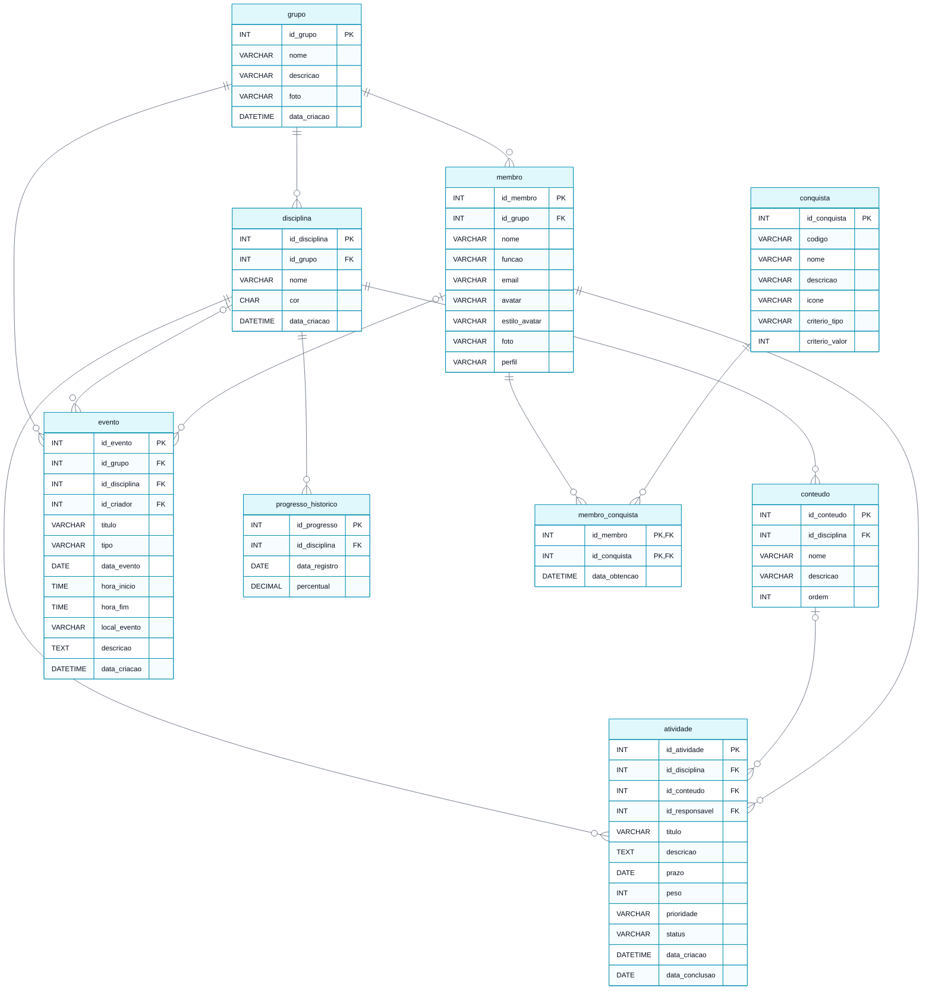

# Modelo Lógico do Banco de Dados

> **Vértice** · Plataforma de Acompanhamento de Aprendizagem
> Entrega 2 · Modelagem do Banco de Dados · Equipe 7 · atualizado em 06/11/2026

---

O modelo lógico transforma as entidades do [modelo conceitual](01-modelo-conceitual.md) em tabelas, com chaves primárias, chaves estrangeiras, tipos de dados e restrições. O relacionamento muitos-para-muitos entre membro e conquista foi resolvido pela tabela associativa `membro_conquista`.

---

## Diagrama do modelo lógico

> Versão em imagem para inserir no documento: [`modelo-logico.png`](modelo-logico.png)

---

## Tabelas

### grupo

| Campo | Tipo | Chave | Nulo | Restrição |
|---|---|---|---|---|
| id_grupo | INT | PK | Não | Auto incremento |
| nome | VARCHAR(80) | | Não | |
| descricao | VARCHAR(255) | | Sim | |
| foto | VARCHAR(255) | | Sim | Endereço da foto do grupo no armazenamento de arquivos (RF29, RN19) |
| data_criacao | DATETIME | | Não | Padrão: data e hora atuais |

### membro

| Campo | Tipo | Chave | Nulo | Restrição |
|---|---|---|---|---|
| id_membro | INT | PK | Não | Auto incremento |
| id_grupo | INT | FK → grupo | Não | `ON DELETE CASCADE` (RN02) |
| nome | VARCHAR(80) | | Não | |
| funcao | VARCHAR(60) | | Sim | |
| email | VARCHAR(120) | | Sim | |
| avatar | VARCHAR(60) | | Sim | Semente do avatar gerado |
| estilo_avatar | VARCHAR(20) | | Não | `DEFAULT 'croodles-neutral'`; `CHECK IN ('croodles-neutral', 'adventurer', 'big-smile', 'fun-emoji', 'pixel-art')` (RF19) |
| foto | VARCHAR(255) | | Sim | Endereço da foto de perfil no armazenamento de arquivos (RF24, RN19) |
| perfil | VARCHAR(15) | | Não | `CHECK IN ('organizador', 'participante')` (RN07) |

### disciplina

| Campo | Tipo | Chave | Nulo | Restrição |
|---|---|---|---|---|
| id_disciplina | INT | PK | Não | Auto incremento |
| id_grupo | INT | FK → grupo | Não | `ON DELETE CASCADE` (RN02) |
| nome | VARCHAR(80) | | Não | `UNIQUE (id_grupo, nome)` |
| cor | CHAR(7) | | Não | Uma das cores da paleta, em hexadecimal; padrão `#3b82f6` (RN18) |
| data_criacao | DATETIME | | Não | Padrão: data e hora atuais |

### conteudo

| Campo | Tipo | Chave | Nulo | Restrição |
|---|---|---|---|---|
| id_conteudo | INT | PK | Não | Auto incremento |
| id_disciplina | INT | FK → disciplina | Não | `ON DELETE CASCADE` (RN02, RN13) |
| nome | VARCHAR(80) | | Não | `UNIQUE (id_disciplina, nome)` |
| descricao | VARCHAR(255) | | Sim | |
| ordem | INT | | Não | Padrão: 1 |

### atividade

| Campo | Tipo | Chave | Nulo | Restrição |
|---|---|---|---|---|
| id_atividade | INT | PK | Não | Auto incremento |
| id_disciplina | INT | FK → disciplina | Não | `ON DELETE CASCADE` (RN02, RN13) |
| id_conteudo | INT | FK → conteudo | Sim | `ON DELETE SET NULL`: excluído o conteúdo, a atividade fica na disciplina (RN02, RN13) |
| id_responsavel | INT | FK → membro | Não | `ON DELETE RESTRICT` (RN02, RN06) |
| titulo | VARCHAR(120) | | Não | `CHECK (LENGTH(titulo) >= 3)` (RN06) |
| descricao | TEXT | | Sim | |
| prazo | DATE | | Não | (RN06) |
| peso | INT | | Não | Padrão 1, `CHECK (peso BETWEEN 1 AND 5)` (RN09) |
| prioridade | VARCHAR(10) | | Sim | `CHECK IN ('baixa', 'media', 'alta')` |
| status | VARCHAR(12) | | Não | Padrão `'a fazer'`, `CHECK IN ('a fazer', 'fazendo', 'concluido')` (RN04) |
| data_criacao | DATETIME | | Não | Padrão: data e hora atuais |
| data_conclusao | DATE | | Sim | Preenchida quando o status passa a `'concluido'` (RN11) |

### evento

| Campo | Tipo | Chave | Nulo | Restrição |
|---|---|---|---|---|
| id_evento | INT | PK | Não | Auto incremento |
| id_grupo | INT | FK → grupo | Não | `ON DELETE CASCADE` (RN02) |
| id_disciplina | INT | FK → disciplina | Sim | `ON DELETE SET NULL`: excluída a disciplina, o evento fica no grupo (RN02) |
| id_criador | INT | FK → membro | Sim | `ON DELETE SET NULL`; quem cadastrou, para a regra de edição (RN21) |
| titulo | VARCHAR(120) | | Não | (RN21) |
| tipo | VARCHAR(12) | | Não | `CHECK IN ('prova', 'apresentacao', 'palestra', 'reuniao', 'outro')` (RN21) |
| data_evento | DATE | | Não | (RN21) |
| hora_inicio | TIME | | Sim | Sem horário, o evento vale o dia todo |
| hora_fim | TIME | | Sim | `CHECK (hora_fim IS NULL OR (hora_inicio IS NOT NULL AND hora_fim > hora_inicio))` (RN21) |
| local_evento | VARCHAR(120) | | Sim | Nenhuma |
| descricao | TEXT | | Sim | Nenhuma |
| data_criacao | DATETIME | | Não | Padrão: data e hora atuais |

### progresso_historico

| Campo | Tipo | Chave | Nulo | Restrição |
|---|---|---|---|---|
| id_progresso | INT | PK | Não | Auto incremento |
| id_disciplina | INT | FK → disciplina | Não | `ON DELETE CASCADE` |
| data_registro | DATE | | Não | `UNIQUE (id_disciplina, data_registro)` |
| percentual | DECIMAL(5,2) | | Não | `CHECK (percentual BETWEEN 0 AND 100)` |

### conquista

| Campo | Tipo | Chave | Nulo | Restrição |
|---|---|---|---|---|
| id_conquista | INT | PK | Não | Auto incremento |
| codigo | VARCHAR(30) | | Não | `UNIQUE` |
| nome | VARCHAR(60) | | Não | |
| descricao | VARCHAR(160) | | Não | |
| icone | VARCHAR(10) | | Sim | |
| criterio_tipo | VARCHAR(30) | | Não | `CHECK IN ('atividades_concluidas', 'conteudo_completo', 'disciplina_completa', 'ofensiva_dias', 'experiencia_total')` |
| criterio_valor | INT | | Não | Valor a ser atingido no critério |

### membro_conquista *(tabela associativa)*

| Campo | Tipo | Chave | Nulo | Restrição |
|---|---|---|---|---|
| id_membro | INT | PK, FK → membro | Não | `ON DELETE CASCADE` |
| id_conquista | INT | PK, FK → conquista | Não | `ON DELETE CASCADE` |
| data_obtencao | DATETIME | | Não | Padrão: data e hora atuais |

A chave primária composta por `id_membro` e `id_conquista` é o que garante a RN12: o banco recusa uma segunda concessão da mesma conquista ao mesmo estudante.

---

## Como as regras de negócio aparecem no banco

| Regra | Implementação no modelo lógico |
|---|---|
| RN02: exclusão em cascata e troca de responsável | `ON DELETE CASCADE` nas chaves estrangeiras de `membro`, `disciplina`, `conteudo`, `atividade.id_disciplina` e `evento.id_grupo`; `ON DELETE SET NULL` em `atividade.id_conteudo` e `evento.id_disciplina`, para que a atividade e o evento continuem quando o conteúdo ou a disciplina saem; `ON DELETE RESTRICT` em `atividade.id_responsavel`, que recusa excluir um membro enquanto ele for responsável por alguma atividade |
| RN04: status válido e padrão | `CHECK` na coluna `status` mais valor padrão `'a fazer'` |
| RN06: título, disciplina, prazo e responsável obrigatórios | `NOT NULL` em `titulo`, `id_disciplina`, `prazo` e `id_responsavel`, mais `CHECK` de comprimento mínimo do título |
| RN07: perfis de usuário | `CHECK` na coluna `perfil` |
| RN09: faixa e padrão do peso | `CHECK (peso BETWEEN 1 AND 5)` mais valor padrão 1 |
| RN12: conquista concedida uma única vez | Chave primária composta em `membro_conquista` |
| RN13: atividade na disciplina, conteúdo opcional | `id_disciplina NOT NULL` e `id_conteudo` aceitando nulo em `atividade` |
| RN21: dados do evento | `NOT NULL` em `titulo`, `tipo` e `data_evento`; `CHECK` no tipo e no horário de `evento` |

### Regras que o banco não consegue garantir sozinho

| Regra | Por quê | Onde será tratada |
|---|---|---|
| RN03: o responsável deve ser membro do mesmo grupo da atividade | A chave estrangeira garante que o responsável é um membro **existente**, mas não que ele pertence ao grupo alcançado por `atividade → disciplina → grupo` | Validação na aplicação, no momento do cadastro, oferecendo na lista apenas os membros do grupo ativo |
| RN13: o conteúdo da atividade é da mesma disciplina dela | As duas chaves estrangeiras são independentes; prender as duas numa chave composta impediria o `SET NULL` quando o conteúdo sai | Validação na aplicação (`lib/validacao.js`): "Esse conteúdo é de outra disciplina." |
| RN21: quem edita o evento | O banco não sabe quem está fazendo a alteração | Hoje, na aplicação (`lib/permissoes.js`). Com o login de 27/11, em políticas de acesso do Supabase: só quem cadastrou ou o organizador |
| RN08, RN14: cálculo do progresso | São fórmulas de agregação, não restrições de integridade | Consulta com `SUM` sobre o peso das atividades, executada na aplicação |
| RN10, RN11: experiência e ofensiva | Valores derivados de `peso` e de `data_conclusao` | Cálculo na aplicação a partir das atividades concluídas |
| RN02: quem assume as atividades de um membro removido | A restrição impede a exclusão, mas a escolha de quem assume é da pessoa | A aplicação pede quem assume, transfere as atividades e só então exclui o membro |
| RN18: cor da paleta | A paleta é da interface e pode mudar entre versões, como mudou em 28/10; prendê-la numa restrição exigiria alterar a tabela a cada mudança | Validação na aplicação e migração dos dados quando uma cor sai da paleta |
| RN19: formato e tamanho da foto | O banco guarda só o endereço; a imagem é enquadrada, recortada e reduzida antes de ser enviada | Validação na aplicação, antes do envio |
| RN07, RN20: quem edita a atividade e quem muda o status | O banco não sabe quem está fazendo a alteração; nenhuma restrição de tabela compara o membro da sessão com o responsável | Hoje, na aplicação (`lib/permissoes.js`). Com o login de 27/11, em políticas de acesso do Supabase: a alteração de `status` só é aceita quando quem está conectado é o responsável |

---

## Nota sobre a implementação da primeira versão

Conforme a restrição de persistência registrada no [Escopo](../docs/05-escopo.md), até a entrega de 06/11 o sistema guarda os dados no navegador. A estrutura utilizada reproduz este modelo lógico: uma coleção por tabela, com os mesmos nomes de campo, os mesmos identificadores e as mesmas chaves estrangeiras. As restrições `CHECK`, `NOT NULL` e a unicidade são aplicadas por validação na aplicação. Enquanto não há armazenamento de arquivos, os campos `membro.foto` e `grupo.foto` guardam a própria imagem reduzida, e não o endereço dela.

A troca para o banco de dados relacional (o PostgreSQL do Supabase, planejado para 27/11, nas tarefas T46 e T47) consiste em criar as tabelas descritas acima e substituir a camada de acesso, sem alterar o modelo. O [script de criação](04-script-criacao.sql) foi escrito para o MySQL 8 na Entrega 2; a versão para o PostgreSQL entra com a T46.

**Exclusão de um grupo.** Com `ON DELETE RESTRICT` no responsável, o grupo é excluído em dois passos, na mesma transação: primeiro as disciplinas, que levam em cascata os conteúdos e as atividades; depois o grupo, que leva os membros, os eventos e as conquistas dos membros. Nessa ordem, nenhum membro sai enquanto ainda é responsável por alguma atividade. O procedimento está no fim do script de criação.

---

### Navegação

[⬅ Anterior: Modelo Conceitual](01-modelo-conceitual.md) · [Índice](../README.md) · [Próximo: Dicionário de Dados ➡](03-dicionario-de-dados.md)
