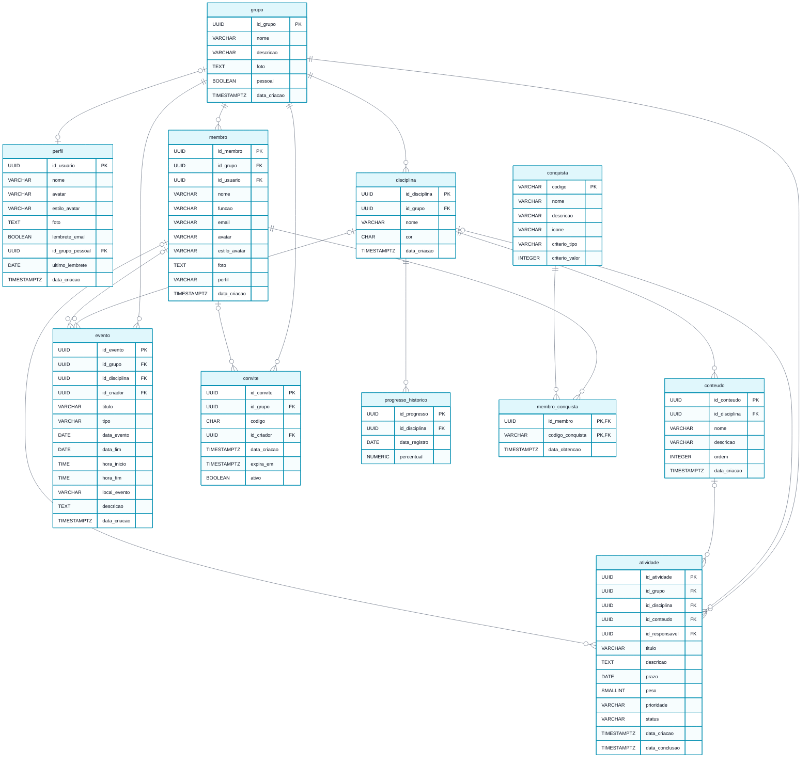
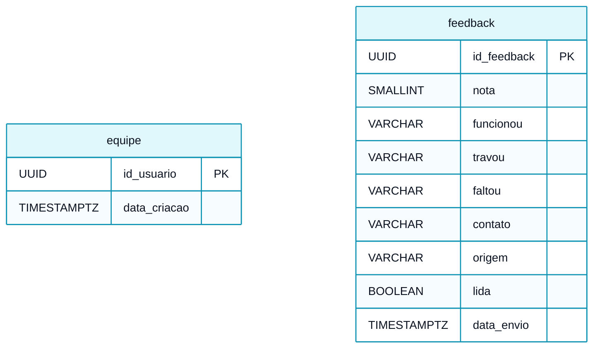

# Modelo Lógico do Banco de Dados

> **Vértice** · Plataforma de Acompanhamento de Aprendizagem
> Entrega 2 · Modelagem do Banco de Dados · Equipe 7 · atualizado em 12/11/2026

---

O modelo lógico transforma as entidades do [modelo conceitual](01-modelo-conceitual.md) em tabelas, com chaves primárias, chaves estrangeiras, tipos de dados e restrições. O relacionamento muitos-para-muitos entre membro e conquista foi resolvido pela tabela associativa `membro_conquista`. O banco é o PostgreSQL do Supabase. O perfil e o membro não têm chave estrangeira entre si: os dois apontam para a mesma conta (`id_usuario`), e é por ela que o perfil identifica os membros da conta em cada grupo.

---

## Diagrama do modelo lógico

Duas tabelas não se ligam às demais e aparecem à parte, abaixo do diagrama na imagem: `feedback`, porque a resposta é anônima (RN27), e `equipe`, que aponta só para a conta (`auth.users`), como o perfil.

> Versão em imagem para inserir no documento: [`modelo-logico.png`](modelo-logico.png)

---

## Tabelas

Os tipos são os do PostgreSQL. Os identificadores são `UUID`, gerados pelo banco (`gen_random_uuid()`) ou pela aplicação, o que permite à tela mostrar um cadastro na hora, antes de o banco responder, sem trocar o identificador depois. As datas com hora são `TIMESTAMPTZ`, com fuso.

### grupo

| Campo | Tipo | Chave | Nulo | Restrição |
|---|---|---|---|---|
| id_grupo | UUID | PK | Não | Padrão `gen_random_uuid()` |
| nome | VARCHAR(80) | | Não | Não pode ser só espaços |
| descricao | VARCHAR(255) | | Sim | |
| foto | TEXT | | Sim | Endereço da foto do grupo no armazenamento de arquivos (RF29, RN19) |
| pessoal | BOOLEAN | | Não | Padrão falso; verdadeiro no espaço pessoal, criado só pela função `garantir_espaco_pessoal` (RF34, RN24) |
| data_criacao | TIMESTAMPTZ | | Não | Padrão: data e hora atuais |

### perfil

| Campo | Tipo | Chave | Nulo | Restrição |
|---|---|---|---|---|
| id_usuario | UUID | PK, FK → conta (`auth.users`) | Não | `ON DELETE CASCADE`; um perfil por conta (RF35) |
| nome | VARCHAR(80) | | Não | Não pode ser só espaços (RN26) |
| avatar | VARCHAR(60) | | Sim | Semente do avatar (RN15) |
| estilo_avatar | VARCHAR(20) | | Não | Padrão `'croodles-neutral'`; `CHECK IN ('croodles-neutral', 'notionists')` |
| foto | TEXT | | Sim | Endereço da foto no armazenamento de arquivos, na pasta do espaço pessoal (RN19) |
| lembrete_email | BOOLEAN | | Não | Padrão verdadeiro (RF36, RN25) |
| id_grupo_pessoal | UUID | FK → grupo | Sim | `UNIQUE`; `ON DELETE SET NULL`; o espaço pessoal da conta (RN24) |
| ultimo_lembrete | DATE | | Sim | Dia do último lembrete enviado; o lembrete sai no máximo uma vez por dia (RN25) |
| data_criacao | TIMESTAMPTZ | | Não | Padrão: data e hora atuais |

A conta não altera `id_usuario`, `id_grupo_pessoal` nem `ultimo_lembrete`: o gatilho `conferir_perfil` mantém os valores anteriores, e só as funções do próprio banco os gravam.

### membro

| Campo | Tipo | Chave | Nulo | Restrição |
|---|---|---|---|---|
| id_membro | UUID | PK | Não | Padrão `gen_random_uuid()` |
| id_grupo | UUID | FK → grupo | Não | `ON DELETE CASCADE` (RN02) |
| id_usuario | UUID | FK → conta (`auth.users`) | Sim | `ON DELETE SET NULL`; vazio enquanto a pessoa não entrou com a própria conta; `UNIQUE (id_grupo, id_usuario)`: uma conta entra uma vez em cada grupo (RF27, RN22) |
| nome | VARCHAR(80) | | Não | Não pode ser só espaços |
| funcao | VARCHAR(60) | | Sim | |
| email | VARCHAR(120) | | Sim | Formato de e-mail |
| avatar | VARCHAR(60) | | Sim | Semente do avatar gerado (RN15) |
| estilo_avatar | VARCHAR(20) | | Não | Padrão `'croodles-neutral'`; `CHECK IN ('croodles-neutral', 'notionists')` (RF19) |
| foto | TEXT | | Sim | Endereço da foto de perfil no armazenamento de arquivos (RF24, RN19) |
| perfil | VARCHAR(15) | | Não | Padrão `'participante'`; `CHECK IN ('organizador', 'participante')` (RN07) |
| data_criacao | TIMESTAMPTZ | | Não | Padrão: data e hora atuais |

### disciplina

| Campo | Tipo | Chave | Nulo | Restrição |
|---|---|---|---|---|
| id_disciplina | UUID | PK | Não | Padrão `gen_random_uuid()` |
| id_grupo | UUID | FK → grupo | Não | `ON DELETE CASCADE` (RN02) |
| nome | VARCHAR(80) | | Não | Único no grupo sem diferenciar maiúsculas: índice único em `(id_grupo, lower(btrim(nome)))` |
| cor | CHAR(7) | | Não | Hexadecimal; padrão `#3b82f6` (RN18) |
| data_criacao | TIMESTAMPTZ | | Não | Padrão: data e hora atuais |

### conteudo

| Campo | Tipo | Chave | Nulo | Restrição |
|---|---|---|---|---|
| id_conteudo | UUID | PK | Não | Padrão `gen_random_uuid()` |
| id_disciplina | UUID | FK → disciplina | Não | `ON DELETE CASCADE` (RN02, RN13) |
| nome | VARCHAR(80) | | Não | Único na disciplina sem diferenciar maiúsculas |
| descricao | VARCHAR(255) | | Sim | |
| ordem | INTEGER | | Não | Padrão 0 |
| data_criacao | TIMESTAMPTZ | | Não | Padrão: data e hora atuais |

### atividade

| Campo | Tipo | Chave | Nulo | Restrição |
|---|---|---|---|---|
| id_atividade | UUID | PK | Não | Padrão `gen_random_uuid()` |
| id_grupo | UUID | FK → grupo | Não | `ON DELETE CASCADE` (RN02); não muda depois de criada (RF34) |
| id_disciplina | UUID | FK → disciplina | Sim | `ON DELETE CASCADE` (RN02, RN13); obrigatória fora do espaço pessoal e do mesmo grupo da atividade, conferido pelo gatilho `conferir_atividade` (RN24) |
| id_conteudo | UUID | FK → conteudo | Sim | `ON DELETE SET NULL`: excluído o conteúdo, a atividade fica na disciplina (RN02, RN13) |
| id_responsavel | UUID | FK → membro | Sim | `ON DELETE NO ACTION` (RN02); vazio é "A definir", e então o status fica em `'a fazer'` (`ck_atividade_a_definir`, RN06) |
| titulo | VARCHAR(120) | | Não | Pelo menos 3 caracteres sem contar os espaços das pontas (RN06) |
| descricao | TEXT | | Sim | |
| prazo | DATE | | Não | (RN06) |
| peso | SMALLINT | | Não | Padrão 1, `CHECK (peso BETWEEN 1 AND 5)` (RN09) |
| prioridade | VARCHAR(10) | | Sim | `CHECK IN ('baixa', 'media', 'alta')` |
| status | VARCHAR(12) | | Não | Padrão `'a fazer'`, `CHECK IN ('a fazer', 'fazendo', 'concluido')` (RN04) |
| data_criacao | TIMESTAMPTZ | | Não | Padrão: data e hora atuais |
| data_conclusao | TIMESTAMPTZ | | Sim | Preenchida exatamente quando o status é `'concluido'` (`CHECK`), e pelo gatilho quando a conclusão chega sem ela (RN11) |

### evento

| Campo | Tipo | Chave | Nulo | Restrição |
|---|---|---|---|---|
| id_evento | UUID | PK | Não | Padrão `gen_random_uuid()` |
| id_grupo | UUID | FK → grupo | Não | `ON DELETE CASCADE` (RN02) |
| id_disciplina | UUID | FK → disciplina | Sim | `ON DELETE SET NULL`: excluída a disciplina, o evento fica no grupo (RN02) |
| id_criador | UUID | FK → membro | Sim | `ON DELETE SET NULL`; quem cadastrou, preenchido pelo banco com o membro da conta conectada (RN21) |
| titulo | VARCHAR(120) | | Não | Não pode ser só espaços (RN21) |
| tipo | VARCHAR(12) | | Não | `CHECK IN ('prova', 'apresentacao', 'palestra', 'reuniao', 'outro')` (RN21) |
| data_evento | DATE | | Não | Primeiro (ou único) dia (RN21) |
| data_fim | DATE | | Sim | Último dia do evento de vários dias; `ck_evento_periodo`: não pode ser antes de `data_evento` (RN21) |
| hora_inicio | TIME | | Sim | Sem horário, o evento vale o dia todo |
| hora_fim | TIME | | Sim | `ck_evento_horas`: só com o início; num dia só, depois dele; em vários dias, vale para o último dia e pode ser qualquer hora (RN21) |
| local_evento | VARCHAR(120) | | Sim | |
| descricao | TEXT | | Sim | |
| data_criacao | TIMESTAMPTZ | | Não | Padrão: data e hora atuais |

### convite

| Campo | Tipo | Chave | Nulo | Restrição |
|---|---|---|---|---|
| id_convite | UUID | PK | Não | Padrão `gen_random_uuid()` |
| id_grupo | UUID | FK → grupo | Não | `ON DELETE CASCADE` (RN02) |
| codigo | CHAR(8) | | Não | `UNIQUE`; letras maiúsculas e números de 2 a 9 (RN22) |
| id_criador | UUID | FK → membro | Sim | `ON DELETE SET NULL`; o organizador que gerou |
| data_criacao | TIMESTAMPTZ | | Não | Padrão: data e hora atuais |
| expira_em | TIMESTAMPTZ | | Não | Padrão: 7 dias depois da criação (RN22) |
| ativo | BOOLEAN | | Não | Padrão verdadeiro |

### progresso_historico

| Campo | Tipo | Chave | Nulo | Restrição |
|---|---|---|---|---|
| id_progresso | UUID | PK | Não | Padrão `gen_random_uuid()` |
| id_disciplina | UUID | FK → disciplina | Não | `ON DELETE CASCADE` |
| data_registro | DATE | | Não | Padrão: o dia atual no horário de Brasília; `UNIQUE (id_disciplina, data_registro)` (RN23) |
| percentual | NUMERIC(5,2) | | Não | `CHECK (percentual BETWEEN 0 AND 100)` |

### conquista

| Campo | Tipo | Chave | Nulo | Restrição |
|---|---|---|---|---|
| codigo | VARCHAR(30) | PK | Não | Os seis marcos da RN12 vêm cadastrados pelo script |
| nome | VARCHAR(60) | | Não | |
| descricao | VARCHAR(160) | | Não | |
| icone | VARCHAR(10) | | Sim | |
| criterio_tipo | VARCHAR(30) | | Não | `CHECK IN ('atividades_concluidas', 'conteudo_completo', 'disciplina_completa', 'ofensiva_dias', 'experiencia_total')` |
| criterio_valor | INTEGER | | Não | Maior que zero |

### membro_conquista *(tabela associativa)*

| Campo | Tipo | Chave | Nulo | Restrição |
|---|---|---|---|---|
| id_membro | UUID | PK, FK → membro | Não | `ON DELETE CASCADE` |
| codigo_conquista | VARCHAR(30) | PK, FK → conquista | Não | `ON DELETE CASCADE` |
| data_obtencao | TIMESTAMPTZ | | Não | Padrão: data e hora atuais |

A chave primária composta por `id_membro` e `codigo_conquista` é o que garante a RN12: o banco recusa uma segunda concessão da mesma conquista ao mesmo estudante. A conquista passou a ser identificada pelo próprio código, que já era único: o identificador numérico separado não acrescentava nada.

### equipe

| Campo | Tipo | Chave | Nulo | Restrição |
|---|---|---|---|---|
| id_usuario | UUID | PK, FK → conta (`auth.users`) | Não | `ON DELETE CASCADE`; preenchida pela equipe direto no banco (RN27) |
| data_criacao | TIMESTAMPTZ | | Não | Padrão: data e hora atuais |

A conta só lê a própria linha, para saber se é da equipe (função `eh_equipe`), e ninguém grava pela API.

### feedback

| Campo | Tipo | Chave | Nulo | Restrição |
|---|---|---|---|---|
| id_feedback | UUID | PK | Não | Gerado pelo banco |
| nota | SMALLINT | | Não | `CHECK (nota BETWEEN 1 AND 5)` |
| funcionou | VARCHAR(1000) | | Sim | O que funcionou bem; em branco vira nulo |
| travou | VARCHAR(1000) | | Sim | O que travou ou confundiu; em branco vira nulo |
| faltou | VARCHAR(1000) | | Sim | O que faltou; em branco vira nulo |
| contato | VARCHAR(120) | | Sim | E-mail ou @, se a pessoa quiser retorno |
| origem | VARCHAR(12) | | Não | Padrão `'visitante'`; `CHECK IN ('visitante', 'demonstracao', 'conta')` |
| lida | BOOLEAN | | Não | Padrão falso |
| data_envio | TIMESTAMPTZ | | Não | Padrão: data e hora atuais; índice `ix_feedback_data` |

O gatilho `conferir_feedback` grava o identificador, a data e "não lida" na inclusão, seja o que for que chegue, recusa mais de 20 respostas no mesmo minuto e, na alteração, mantém tudo menos `lida`.

---

## Como as regras de negócio aparecem no banco

| Regra | Implementação no banco |
|---|---|
| RN01: cada grupo só enxerga o que é dele | Regras de acesso por linha (*row level security*) em todas as tabelas: uma conta só lê e altera as linhas dos grupos de que é membro (função `eh_membro`), e só o próprio perfil |
| RN02: exclusão em cascata e troca de responsável | `ON DELETE CASCADE` nas chaves de `membro`, `disciplina`, `conteudo`, `atividade.id_disciplina`, `evento.id_grupo` e `convite`; `ON DELETE SET NULL` em `atividade.id_conteudo` e `evento.id_disciplina`; `ON DELETE NO ACTION` em `atividade.id_responsavel`, que recusa excluir um membro enquanto ele for responsável por alguma atividade. O `NO ACTION` confere ao fim do comando, e por isso a exclusão do grupo inteiro, que leva membros e atividades juntos, não é barrada |
| RN03: responsável do mesmo grupo | Gatilho `conferir_atividade`: recusa responsável de outro grupo e, no espaço pessoal, põe o dono como responsável |
| RN04: status válido e padrão | `CHECK` e valor padrão em `status` |
| RN06: título, prazo e disciplina obrigatórios; responsável "A definir" | `NOT NULL` e `CHECK` de comprimento do título; `ck_atividade_a_definir`; gatilho `conferir_atividade`, que exige a disciplina fora do espaço pessoal e, numa atividade "A definir", deixa quem não é organizador só assumir. A regra de acesso `atividade_editar` deixa qualquer membro alterar a atividade sem responsável |
| RN07: permissões do organizador | Regras de acesso: só o organizador (função `eh_organizador`) grava em `disciplina`, `conteudo` e `convite`, edita e exclui o grupo e gerencia membros; cada um edita o próprio cadastro. Gatilho `conferir_membro`: o último organizador não é rebaixado nem removido, e só o organizador muda o perfil |
| RN09: faixa e padrão do peso | `CHECK (peso BETWEEN 1 AND 5)` e valor padrão 1 |
| RN11: data de conclusão | `CHECK` que liga `status = 'concluido'` a `data_conclusao` preenchida, e o gatilho `conferir_atividade`, que preenche e limpa a data |
| RN12: conquista concedida uma única vez e retirada com a experiência | Chave primária composta em `membro_conquista`; cada conta grava e retira (`membro_conquista_retirar`) só as próprias conquistas |
| RN13: atividade na disciplina, conteúdo opcional e da mesma disciplina | Gatilho `conferir_atividade`, que exige a disciplina nos grupos, confere que ela é do grupo da atividade e recusa conteúdo de outra disciplina; `id_conteudo` aceitando nulo |
| RN20: só o responsável muda o status | Gatilho `conferir_atividade`: compara o responsável com o membro da conta conectada (`membro_atual`) |
| RN21: dados e permissões do evento | `NOT NULL` e `CHECK` em `evento`; regras de acesso: edita e exclui quem cadastrou ou o organizador; gatilho `conferir_evento`: grava quem cadastrou e confere a disciplina |
| RN22: convite | Tabela `convite` e a função `entrar_com_codigo`, que confere o código e a validade, liga a conta ao cadastro com o mesmo e-mail ou cria o membro participante |
| RN23: registro diário do progresso | Gatilho `registrar_progresso`, depois de cada inclusão, exclusão ou mudança de status, peso ou disciplina de uma atividade |
| RN24: espaço pessoal | Coluna `grupo.pessoal` e a função `garantir_espaco_pessoal`, que cria o espaço e o perfil uma vez por conta; as regras de acesso não deixam criar nem excluir um grupo pessoal pela API, nem cadastrar membros ou convites nele, e a função `entrar_com_codigo` recusa o espaço pessoal |
| RN25: lembrete por e-mail | Funções `lembretes_do_dia` (quem recebe e o quê) e `enviar_lembretes` (monta e envia pelo Brevo e grava `ultimo_lembrete`), sem permissão de execução para as contas; agendamento diário com o pg_cron |
| RN26: perfil em todos os grupos | Tabela `perfil`, editável só pela própria conta; `entrar_com_codigo` cria o membro com o nome e a foto do perfil |
| RN27: feedback anônimo, lido só pela equipe | Qualquer um inclui em `feedback`, com ou sem conta; só quem está em `equipe` (função `eh_equipe`) lê, marca como lida e exclui; gatilho `conferir_feedback`, com o limite de 20 respostas por minuto |

### Regras que continuam na aplicação

| Regra | Por quê |
|---|---|
| RN08, RN14: cálculo do progresso | O percentual atual é derivado das atividades e calculado na tela, que mostra o efeito na hora. O banco só o grava, uma vez por dia, para o histórico (RN23) |
| RN10, RN11: experiência e ofensiva | Valores derivados de `peso` e de `data_conclusao`, calculados a partir das atividades concluídas |
| RN18: cor da paleta | A paleta é da interface e pode mudar entre versões, como mudou em 28/10; o banco confere só o formato |
| RN19: formato e tamanho da foto | A imagem é enquadrada, recortada e reduzida antes de ser enviada; o armazenamento de arquivos aceita só JPEG de até 1 MB, e só na pasta de um grupo de que a conta é membro |
| RN26: nome e foto do perfil nos membros da conta | A aplicação leva o perfil aos membros da conta em cada grupo. O banco guarda as duas cópias para o membro cadastrado pelo organizador, que ainda não tem conta, continuar com nome e foto |

## Do navegador para o banco

Até a entrega de 06/11 o sistema guardava os dados no navegador, numa estrutura que reproduzia este modelo: uma coleção por tabela, com os mesmos campos e as mesmas chaves. Com conta, desde a entrega de 27/11, os dados ficam nas tabelas acima, no PostgreSQL do Supabase; o modo de demonstração continua usando o navegador, com a mesma estrutura. O [script de criação](04-script-criacao.sql) cria as tabelas, as funções de apoio, os gatilhos, as regras de acesso, o espaço das fotos e o lembrete por e-mail; num banco que já tem dados, a [atualização de 11/11](07-atualizacao-11-11.sql) acrescenta o que mudou sem apagar nada, dando a cada atividade o grupo da sua disciplina; e as [verificações](05-verificacoes.sql) conferem as regras num PostgreSQL local (com o [apoio](06-apoio-teste-local.sql) que imita as partes do Supabase de que o script depende).

---

### Navegação

[⬅ Anterior: Modelo Conceitual](01-modelo-conceitual.md) · [Índice](../README.md) · [Próximo: Dicionário de Dados ➡](03-dicionario-de-dados.md)
