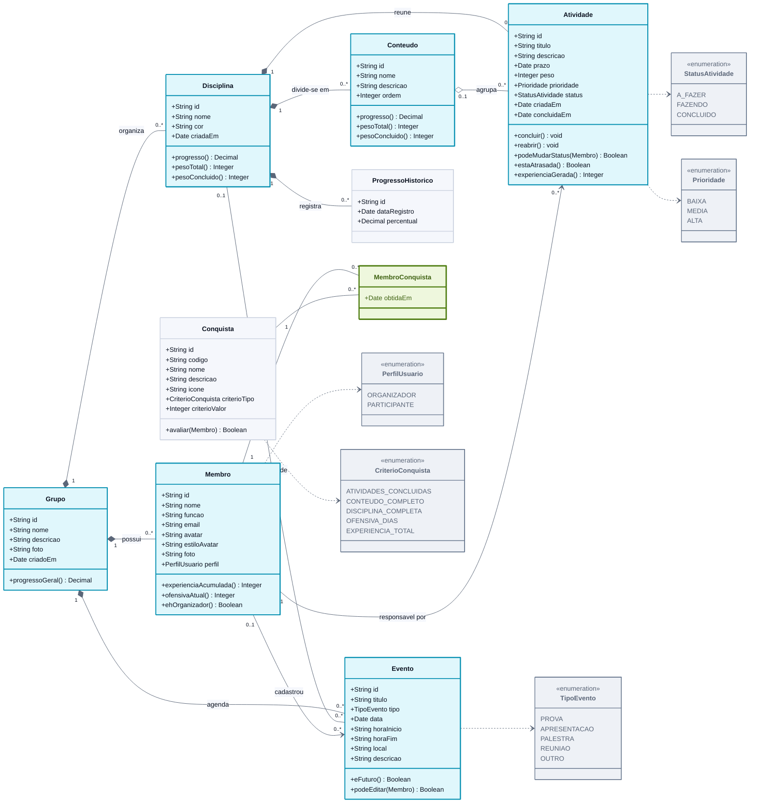

# Diagrama de Classes

> **Vértice** · Plataforma de Acompanhamento de Aprendizagem
> Entrega 2 · Modelagem do Software · Equipe 7 · atualizado em 06/11/2026

---

O diagrama apresenta as nove classes do domínio, seus atributos principais e os relacionamentos com cardinalidade. Os losangos preenchidos indicam **composição**: a existência da parte depende do todo, o que corresponde à cascata de exclusão descrita na RN02.

> Versão em imagem para inserir no documento: [`png/diagrama-de-classes.png`](png/diagrama-de-classes.png)

---

## Leitura dos relacionamentos

| Relacionamento | Cardinalidade | Leitura |
|---|---|---|
| Grupo e Membro | 1 : 0..N | Um grupo possui vários membros; cada membro pertence a exatamente um grupo |
| Grupo e Disciplina | 1 : 0..N | Um grupo organiza várias disciplinas; cada disciplina pertence a um único grupo |
| Disciplina e Conteúdo | 1 : 0..N | Uma disciplina divide-se em vários conteúdos; cada conteúdo pertence a uma única disciplina (RN13) |
| Disciplina e Atividade | 1 : 0..N | Uma disciplina reúne várias atividades; cada atividade pertence a exatamente uma disciplina (RN13) |
| Conteúdo e Atividade | 0..1 : 0..N | Um conteúdo agrupa várias atividades; a atividade pode estar em nenhum ou em um conteúdo, sempre da sua disciplina. Excluído o conteúdo, a atividade fica na disciplina (RN02, RN13) |
| Membro e Atividade | 1 : 0..N | Um membro pode ser responsável por várias atividades; toda atividade tem exatamente um responsável (RN06). Antes de um membro ser removido, as atividades dele passam para outro membro do grupo (RN02) |
| Grupo e Evento | 1 : 0..N | Um grupo agenda vários eventos; cada evento pertence a um único grupo (RF31) |
| Disciplina e Evento | 0..1 : 0..N | Um evento pode ser de uma disciplina; excluída a disciplina, o evento fica no grupo, sem disciplina (RN02) |
| Membro e Evento | 0..1 : 0..N | O evento guarda quem o cadastrou; ele e o organizador editam e excluem (RN21) |
| Disciplina e ProgressoHistorico | 1 : 0..N | Uma disciplina acumula vários registros de progresso ao longo do tempo (RF12) |
| Membro e Conquista | 0..N : 0..N | Um membro obtém várias conquistas e uma conquista é obtida por vários membros. A associação é resolvida pela classe associativa **MembroConquista**, que guarda a data de obtenção (RN12) |

---

## Observações de projeto

**Experiência e ofensiva são calculadas, não armazenadas.** `Membro.experienciaAcumulada()` soma `Atividade.experienciaGerada()` das atividades concluídas sob sua responsabilidade, e `Membro.ofensivaAtual()` percorre as datas em `Atividade.concluidaEm`. Guardar esses valores em atributos criaria uma segunda fonte de verdade que precisaria ser sincronizada a cada alteração de status, inclusive nas reversões previstas na RN10.

**O progresso também é calculado.** `Conteudo.progresso()` e `Disciplina.progresso()` aplicam diretamente as fórmulas da RN08 e da RN14. A classe **ProgressoHistorico** não duplica esse cálculo: ela guarda o resultado de um dia específico, porque a evolução ao longo do tempo (RF12) não pode ser reconstruída a partir do estado atual.

**A Conquista é um catálogo.** Ela não pertence a nenhum grupo: descreve o marco e o critério de avaliação. Quem liga o marco ao estudante é a classe associativa MembroConquista.

**A foto e o avatar convivem no Membro.** `foto` guarda a foto de perfil enviada pela pessoa e enquadrada no editor (RF24, RN19) e, quando existe, é ela que aparece; `avatar` guarda a semente do avatar sorteado e `estiloAvatar`, qual dos dois estilos de desenho (Rabisco ou Ilustrado) a pessoa escolheu; o avatar é usado quando não há foto e é desenhado pelo próprio sistema a partir dos dois (RF19, RN15).

**O grupo também tem foto.** `Grupo.foto` guarda a foto do grupo, enquadrada do mesmo jeito (RF29, RN19); sem ela, as telas mostram as iniciais do nome do grupo.

**Evento não é atividade.** A atividade é trabalho de alguém e entra no progresso; o evento é algo que acontece num dia, sem responsável, peso nem status. `Evento.eFuturo()` decide se ele aparece em Próximos ou em Passados, e `Evento.podeEditar(Membro)` é verdadeiro para quem o cadastrou e para o organizador (RN21).

**Só o responsável muda o status.** `Atividade.podeMudarStatus(Membro)` só é verdadeiro para o membro responsável pela atividade (RN20): é a ele que `concluir()` e `reabrir()` são oferecidos, porque é ele quem recebe a experiência (RN10).

---

### Navegação

[⬅ Anterior: Casos de Uso](01-casos-de-uso.md) · [Índice](../README.md) · [Próximo: Fluxo: Concluir Atividade ➡](03-atividade-concluir.md)
