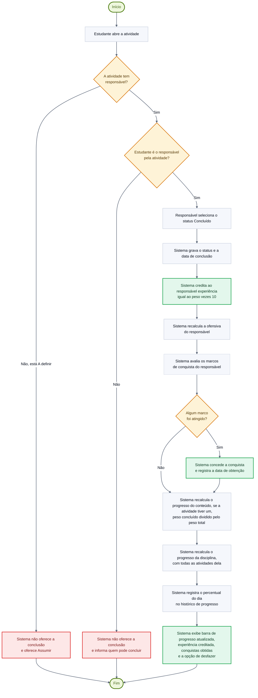
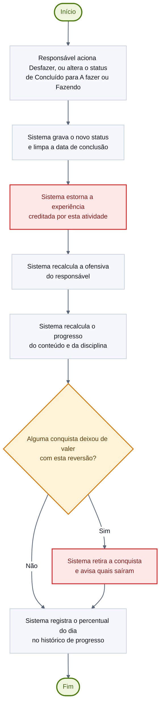

# Diagrama de Atividades: Concluir atividade e recalcular progresso

> **Vértice** · Plataforma de Acompanhamento de Aprendizagem
> Entrega 2 · Modelagem do Software · Equipe 7 · atualizado em 11/11/2026

---

Este é o processo central do sistema: é nele que a execução de uma atividade se transforma em medida de aprendizagem. Corresponde ao [UC07 · Concluir atividade](../docs/10-casos-de-uso.md#uc07--concluir-atividade) e aos requisitos RF05, RF15, RF16 e RF17. Só o responsável pela atividade chega à conclusão (RN20).

> Versão em imagem para inserir no documento: [`png/fluxo-concluir-atividade.png`](png/fluxo-concluir-atividade.png)

---

## Fluxo de reversão

A RN10 prevê que a experiência seja estornada quando a atividade deixa de estar concluída. Desde 11/11/2026, a RN12 retira junto as conquistas que só valiam por causa dessa conclusão: quem conclui por engano e desfaz não fica com o "Primeiro Passo". A comparação é entre antes e depois da reversão, no mesmo dia, e por isso uma ofensiva que já tinha terminado não retira conquista nenhuma. O diagrama abaixo detalha esse caminho.

> Versão em imagem para inserir no documento: [`png/fluxo-reverter-conclusao.png`](png/fluxo-reverter-conclusao.png)

---

## Decisões representadas

| Decisão | Origem | Consequência |
|---|---|---|
| Estudante é o responsável pela atividade? | RN20 | Só quem é responsável conclui ou reabre a atividade. Os outros integrantes (o organizador inclusive) veem a situação, mas não a alteram; o organizador continua podendo editar os dados e excluir a atividade (RN07) |
| A atividade tem responsável? | RN06 | A atividade "A definir" não é concluída: primeiro alguém a assume (UC19), e daí em diante vale a RN20 |
| Algum marco foi atingido? | RN12 | A conquista é concedida uma única vez, no instante em que a condição passa a ser satisfeita |
| Alguma conquista deixou de valer com esta reversão? | RN12 | Sai só o que a reversão derrubou, comparando antes e depois no mesmo dia; a pessoa é avisada de cada conquista retirada |

Os dois fluxos não decidem a quem creditar ou de quem estornar a experiência: só a atividade com responsável é concluída (RN06), é ele quem conclui (RN20) e é sempre ele quem recebe.

---

### Navegação

[⬅ Anterior: Classes](02-classes.md) · [Índice](../README.md) · [Próximo: Fluxo: Cadastrar Atividade ➡](04-atividade-cadastrar.md)
