# Diagrama de Atividades · Cadastrar atividade na disciplina, com conteúdo opcional

> **Vértice** · Plataforma de Acompanhamento de Aprendizagem
> Entrega 2 · Modelagem do Software · Equipe 7 · atualizado em 06/11/2026

---

Segundo processo central: é o cadastro que ancora a atividade na estrutura de aprendizagem. Corresponde ao [UC05 · Cadastrar atividade](../docs/10-casos-de-uso.md#uc05--cadastrar-atividade) e aos requisitos RF03 e RF30, aplicando as regras RN03, RN04, RN06, RN07, RN09, RN13 e RN20.

```mermaid
%%{init: {"theme": "base", "fontFamily": "Space Grotesk", "themeVariables": {"fontFamily": "Space Grotesk, Segoe UI, sans-serif", "fontSize": "15px", "primaryColor": "#F5F7FC", "primaryTextColor": "#0B1220", "primaryBorderColor": "#CDD4E1", "lineColor": "#5B6678", "secondaryColor": "#EEF7DD", "tertiaryColor": "#FAFBFE", "clusterBkg": "#FAFBFE", "clusterBorder": "#CDD4E1", "edgeLabelBackground": "#FFFFFF", "titleColor": "#0E7490", "nodeBorder": "#CDD4E1", "mainBkg": "#F5F7FC", "textColor": "#0B1220"}, "flowchart": {"curve": "basis", "padding": 18, "nodeSpacing": 48, "rankSpacing": 58}}}%%
flowchart TD
    INI([Início]) --> C1[Estudante aciona Nova atividade]
    C1 --> D0{Existe disciplina<br/>cadastrada no grupo?}

    D0 -- Não --> C2[Sistema informa a necessidade de<br/>cadastrar a disciplina antes]
    C2 --> C3[Organizador cadastra a disciplina]
    C3 --> C5

    D0 -- Sim --> C5[Sistema exibe o formulário da atividade,<br/>com os campos vazios]
    C5 --> C6[Estudante seleciona a disciplina]
    C6 --> C7[Sistema filtra os conteúdos<br/>apenas os da disciplina escolhida]
    C7 --> D3{Separar a atividade<br/>num conteúdo?}
    D3 -- Não --> C8[Estudante preenche título, descrição,<br/>prazo no calendário, peso, prioridade e responsável]
    D3 -- Sim, um que existe --> C8
    D3 -- Sim, um novo --> C4[Organizador cria o conteúdo numa janela,<br/>sem sair do formulário]
    C4 --> C4b[Sistema grava o conteúdo e o deixa escolhido,<br/>mantendo o que já foi preenchido]
    C4b --> C8
    C8 --> D4{O responsável é<br/>quem está cadastrando?}
    D4 -- Sim --> C8b[Estudante pode escolher o status]
    D4 -- Não --> C8c[Status travado:<br/>a atividade começa em A fazer]
    C8b --> C9[Estudante confirma]
    C8c --> C9

    C9 --> D1{Título com 3 ou mais caracteres, disciplina,<br/>prazo válido e responsável?}
    D1 -- Não --> C10[Sistema destaca cada campo inválido<br/>com mensagem específica]
    C10 --> C8

    D1 -- Sim --> C11[Sistema aplica os padrões:<br/>status A fazer e peso 1 quando não informados]
    C11 --> D2{Prazo coincide com feriado<br/>nacional ou fim de semana?}
    D2 -- Sim --> C12[Sistema exibe o aviso do feriado ou<br/>do fim de semana sem impedir o cadastro]
    D2 -- Não --> C13
    C12 --> C13[Sistema grava a atividade<br/>e registra a data de criação]

    C13 --> C14[Sistema soma o peso da atividade ao peso total<br/>da disciplina e, se houver, do conteúdo]
    C14 --> C15[Sistema atualiza a listagem<br/>e o progresso do conteúdo e da disciplina]
    C15 --> FIM([Fim])

    classDef ator fill:#E0F7FC,stroke:#0891B2,stroke-width:2.5px,color:#0B1220
    classDef externo fill:#EEF1F6,stroke:#64748B,stroke-width:2px,color:#0B1220,stroke-dasharray:5 4
    classDef uc fill:#FFFFFF,stroke:#0891B2,stroke-width:1.6px,color:#0B1220
    classDef terminal fill:#EEF7DD,stroke:#4D7C0F,stroke-width:2.5px,color:#3F6212
    classDef acao fill:#F5F7FC,stroke:#CDD4E1,stroke-width:1.6px,color:#0B1220
    classDef decisao fill:#FEF3D7,stroke:#D97706,stroke-width:2px,color:#5C3A05
    classDef ganho fill:#E3F7EC,stroke:#16A34A,stroke-width:2px,color:#0B3D21
    classDef erro fill:#FDE7E7,stroke:#DC2626,stroke-width:2px,color:#7F1616
    class INI,FIM terminal
    class D0,D1,D2,D3,D4 decisao
    class C1,C2,C3,C4,C4b,C5,C6,C7,C8,C8b,C8c,C9,C11,C13 acao
    class C10 erro
    class C12 decisao
    class C14,C15 ganho
    linkStyle default stroke:#5B6678,stroke-width:1.6px
```

> Versão em imagem para inserir no documento: [`png/fluxo-cadastrar-atividade.png`](png/fluxo-cadastrar-atividade.png)

---

## Decisões representadas

| Decisão | Origem | Consequência |
|---|---|---|
| Existe disciplina cadastrada no grupo? | RN13 | Toda atividade precisa de uma disciplina. Sem disciplina, o fluxo desvia para o cadastro dela antes de prosseguir |
| Separar a atividade num conteúdo? | RF30, RN07, RN13 | O conteúdo é opcional: sem ele, a atividade fica direto na disciplina. Para um conteúdo novo, o organizador o cria ali mesmo, na disciplina escolhida, e volta ao formulário com tudo o que já tinha preenchido. O participante não cria conteúdo: escolhe um dos existentes ou nenhum |
| O responsável é quem está cadastrando? | RN20 | Só o responsável decide o status. Cadastrada para outra pessoa, a atividade começa em "a fazer" |
| Título, disciplina, prazo e responsável válidos? | RN06, RN13, RNF03 | O sistema não grava dados incompletos e devolve a mensagem no próprio campo, preservando o que já foi digitado. Toda atividade tem um responsável |
| Prazo coincide com feriado nacional ou fim de semana? | RF07, RF22 | O feriado e o fim de semana são avisos, não impedimentos. A atividade é gravada normalmente |

---

## Observação sobre o peso

O passo "soma o peso da atividade ao peso total" não corresponde a um campo gravado: o peso total é obtido pela soma dos pesos das atividades da disciplina, ou do conteúdo, no momento do cálculo (RN08, RN14). O passo está no diagrama porque representa o efeito visível para o usuário: o percentual de progresso cai quando uma atividade nova é adicionada, já que o denominador aumenta.

---

### Navegação

[⬅ Anterior: Fluxo: Concluir Atividade](03-atividade-concluir.md) · [Índice](../README.md) · [Próximo: Modelo Conceitual ➡](../banco-de-dados/01-modelo-conceitual.md)
