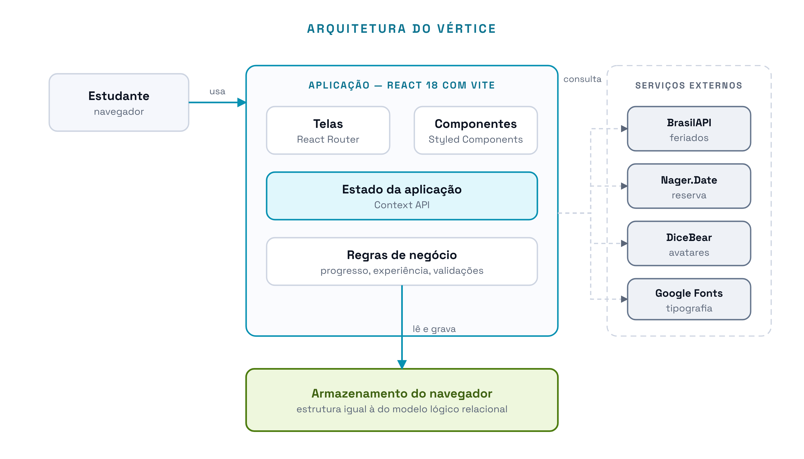

# 13 · Arquitetura e Tecnologias

> **Vértice** · Plataforma de Acompanhamento de Aprendizagem
> Documento de Visão e Requisitos · Imersão Profissional: Projeto de Software · ADSIS4S · Entrega 3, atualizada em 06/11/2026

---

O Vértice é uma aplicação web que roda inteiramente no navegador. Até a entrega de 06/11 não há servidor de aplicação próprio: as regras de negócio e a persistência acontecem no mesmo lugar em que a interface é desenhada. A escolha está registrada como restrição no [Escopo](05-escopo.md). Para a entrega final, os dados passam para um banco de dados hospedado, como descrito no fim deste documento.

---

> Desenho-fonte: [`../diagramas/svg/arquitetura.svg`](../diagramas/svg/arquitetura.svg)

O desenho mostra os componentes que o sistema usa hoje. À esquerda o estudante, que recebe o sistema da Vercel, onde ele está publicado; no meio a aplicação; embaixo a persistência. À direita, fora da fronteira, os serviços que a aplicação consulta mas que não guardam nada do grupo. O banco de dados do Supabase não aparece no desenho porque ainda não é usado; ele entra no desenho junto com a implementação, na entrega de 27/11.

Em 19/10/2026, no início do 2º bimestre, as escolhas da Entrega 3 foram conferidas com o código e confirmadas. Em 28/10/2026, com a nova identidade visual e os pedidos da professora, a camada de estilo, a tipografia e a hospedagem mudaram, e o banco de dados foi escolhido. Em 29/10/2026 entraram duas peças do Radix (a lista de escolha e a janela flutuante) para os filtros, as listas dos formulários e o calendário do campo de data. Em 03/11/2026 entraram os eventos, como mais uma coleção de dados, a versão 3 dos dados, que liga a atividade direto à disciplina, e o movimento da página inicial, feito só com CSS e com as APIs do próprio navegador, sem biblioteca nova. As mudanças estão registradas no [Histórico de Alterações](09-historico-de-alteracoes.md).

---

## Camadas

| Camada | Tecnologia escolhida | Justificativa |
|---|---|---|
| **Interface** | React 18 com Vite | Stack que a equipe já domina. O Vite dá servidor de desenvolvimento rápido e build de produção com configuração mínima, o que importa num prazo de bimestre |
| **Roteamento** | React Router 7 | Rotas públicas e privadas sem biblioteca adicional. A rota privada é o que separa "fora da sessão" de "dentro da sessão" no mapa de navegação |
| **Estilo** | Tailwind CSS 4 | A nova identidade visual foi construída com classes utilitárias no próprio componente. Os tokens de cor dos temas claro e escuro ficam num arquivo só, `src/index.css`, e o Tailwind gera apenas as classes que as telas usam |
| **Componentes acessíveis** | Radix UI | Diálogos, confirmações, menus, dicas, listas de escolha e a janela do calendário do prazo já resolvem teclado, foco e leitor de tela, que são as partes mais fáceis de errar nesses componentes. A lista de escolha do Radix aceita conteúdo próprio em cada opção (a cor da disciplina, a foto do membro), o que o `select` nativo do navegador não permite |
| **Avatares** | DiceBear, como biblioteca | Cinco estilos de desenho, gerados no próprio navegador a partir de uma semente. A imagem não é guardada: a semente e o estilo a reproduzem |
| **Ícones e avisos** | Lucide e Sonner | Ícones em SVG com o mesmo traço em todas as telas, e avisos curtos no canto da tela para retornos como "Atividade excluída" ou uma conquista nova |
| **Tipografia** | Inter Tight e JetBrains Mono, servidas junto com o sistema | A Inter Tight dá o texto e a JetBrains Mono entra nos números, para alinhar datas e percentuais. Os arquivos das fontes vão junto com o sistema, sem depender do Google Fonts |
| **Estado** | Context API | Suficiente para o volume de dados de um grupo de estudo. Uma biblioteca de estado externa resolveria um problema que o projeto não tem |
| **Persistência** | Armazenamento do navegador até 06/11; PostgreSQL no Supabase em 27/11 | O armazenamento do navegador eliminou a necessidade de servidor no primeiro bimestre. A estrutura gravada é a mesma do modelo lógico relacional, então a troca pelo banco exige mudar a camada de acesso, não remodelar os dados |
| **Servidor** | Não há até 06/11; Supabase em 27/11 | Sem servidor não há autenticação, e por isso o acesso é pela seleção do grupo. O Supabase dá banco, autenticação e armazenamento de arquivos sem que a equipe precise manter um servidor próprio |
| **Hospedagem** | Vercel | Publicação gratuita de site estático, refeita a cada atualização no GitHub. O `vercel.json` manda qualquer endereço para o `index.html`, porque as rotas são resolvidas no navegador |

---

## Serviços externos

Dois serviços de terceiros, gratuitos e sem contrato de nível de serviço. Cada um tem alternativa local prevista, porque nenhum deles pode derrubar a tela (RNF10).

| Serviço | Para quê | Se ficar indisponível |
|---|---|---|
| **BrasilAPI** | Feriados nacionais | O sistema consulta a fonte reserva (RN17) |
| **Nager.Date** | Fonte reserva dos feriados | O sistema reutiliza a última relação obtida; não havendo nenhuma, omite a sinalização e avisa |

Nenhum deles recebe dado do grupo. A comunicação é de mão única: o sistema pede, o serviço responde. Isso é o que os torna atores secundários no [diagrama de casos de uso](../diagramas/01-casos-de-uso.md) e não participantes do domínio.

Até 01/11/2026 os avatares também vinham de fora, do serviço da DiceBear. Desde então a mesma DiceBear entra como biblioteca, instalada junto com o sistema: o avatar é desenhado no próprio navegador, a partir de `membro.avatar` (a semente) e `membro.estilo_avatar` (um de cinco estilos). O avatar aparece mesmo sem internet, e a página não pede imagem a nenhum outro endereço.

A foto de perfil e a do grupo não passam por serviço externo: a pessoa as enquadra num editor feito no próprio sistema, e a área enquadrada é recortada e reduzida no navegador antes de ser gravada (RN19). O editor não usa biblioteca: a imagem é decodificada fora da linha principal do navegador e o arraste e o zoom são só uma transformação de posição e escala, desenhada pela placa de vídeo, e por isso uma foto de celular não trava a tela.

---

## Onde ficam as regras de negócio

As regras não estão espalhadas pelas telas. Ficam em módulos próprios, consumidos por quem precisar:

| Regra | Onde vive | Requisito |
|---|---|---|
| Cálculo do progresso de conteúdo e de disciplina | `lib/progresso.js` | RN08, RN14 |
| Crédito e estorno de experiência, ofensiva e conquistas | `lib/gamificacao.js` | RN10, RN11, RN12 |
| Validação de título, disciplina, prazo, responsável, peso, vínculos, perfis e eventos | `lib/validacao.js` | RN03, RN06, RN07, RN09, RN13, RN21 |
| Quem muda o status, edita e exclui cada atividade, e quem edita cada evento | `lib/permissoes.js`, usado pelas telas por `hooks/usePermissoes.js` | RN07, RN20, RN21 |
| Paleta de cores das disciplinas | `lib/constants.js` | RN18 |
| Formato, enquadramento, recorte e redução das fotos | `lib/foto.js` | RN19 |
| Classificação de atraso e urgência do prazo | `lib/datas.js` e `lib/situacoes.js` | RN05, RN16 |
| Cadeia de obtenção dos feriados | `lib/feriados.js` | RN17 |
| Migração dos dados das versões anteriores (versão 3 desde 03/11: disciplina na atividade, conteúdo opcional e estilos de avatar) | `lib/migracao.js` | RN06, RN13, RN15, RN18 |
| Exclusão em cascata, troca de responsável, atividades que ficam sem conteúdo e isolamento por grupo | `context/DataContext.jsx` | RN01, RN02, RN13 |

Concentrar o cálculo fora da tela é o que permite que a mesma regra alimente o painel, o calendário, a tela de disciplinas e o detalhe da atividade sem ser reescrita, e é o que torna a troca para o banco de dados uma mudança de camada, e não uma reescrita.

---

## Ambiente de desenvolvimento

| Item | Versão ou valor |
|---|---|
| Node.js | 20 ou superior (executado e testado com 22.22.0) |
| npm | 10.9.4 |
| React | 18.3.1 |
| Vite | 6.4.5 |
| React Router | 7.18.5 |
| Tailwind CSS | 4.3.3 |
| Radix UI | diálogo 1.3.1, confirmação 1.2.1, menu 2.2.1, dica 1.4.1, lista de escolha 2.4.1 e janela flutuante 1.3.1 |
| DiceBear | núcleo 9.4.3 e os estilos Croodles Neutral, Adventurer, Big Smile, Fun Emoji e Pixel Art, todos 9.4.3 |
| Navegador | Chrome, Edge ou Firefox atuais |
| Variáveis de ambiente | Não se aplica até 06/11: o sistema não usa chave, senha nem token. Com o Supabase, os nomes das variáveis entram num `.env.example`, sem os valores |
| Armazenamento inicial | Não há banco a preparar. O navegador cria as coleções no primeiro uso; para testar com dados fictícios, use "Carregar dados de exemplo" na tela de acesso |

As versões das bibliotecas são as fixadas no `package-lock.json`. Por isso a instalação usa `npm ci` quando se quer repetir exatamente o ambiente testado, e o `npm audit` não aponta nenhuma vulnerabilidade. Os comandos estão no [README](../README.md#como-rodar).

`node_modules/` e `dist/` ficam fora do versionamento, pelo `.gitignore`.

---

## Organização das pastas

Onde mexer para alterar cada parte do sistema. Os caminhos de código são relativos a `src/`.

| Para alterar | Onde |
|---|---|
| Telas do sistema | `src/pages/`, uma tela por arquivo |
| Páginas públicas: início, Sobre nós, acesso e 404 | `src/pages/publicas/`, com o movimento da página inicial em `src/components/publicas/movimento.jsx` |
| Eventos: cadastro, cartão e menu de ações | `src/components/eventos/` e a tela `src/pages/Eventos.jsx` |
| Link do formulário de feedback | `src/lib/feedback.js`, lido pela página inicial, pelo rodapé e pelo menu da conta |
| Peças de interface reaproveitadas | `src/components/`, com os componentes base em `src/components/ui/`, entre eles a lista de escolha (`selecao.jsx`), o campo de data (`campo-data.jsx`) e o editor de foto (`editor-foto.jsx`) |
| Barra do topo e layout das páginas públicas | `src/components/layout/` |
| Cores dos temas claro e escuro | `src/index.css` |
| Regras de negócio | `src/lib/`: progresso, gamificação, validação, permissões, datas, situações, foto e migração |
| Dados: leitura, gravação, exclusão em cascata | `src/lib/storage.js` e `src/context/DataContext.jsx` |
| Sessão e perfil de quem está usando | `src/context/AuthContext.jsx` |
| Rotas | `src/App.jsx` e `src/routes/` |
| Serviços externos | `src/lib/feriados.js` e `src/lib/avatar.js` |
| Publicação na Vercel | `vercel.json` |
| Testes automatizados das regras | `verificacoes/`, que rodam com `npm run verificar` |
| Casos de teste e evidências | `docs/15-casos-de-teste.md` e `testes/` na raiz do repositório |

---

## O caminho até o banco de dados

A modelagem relacional da Entrega 2 não é um exercício paralelo à implementação. O armazenamento do navegador guarda os mesmos conjuntos de dados, com as mesmas chaves e os mesmos vínculos do modelo lógico, inclusive a tabela `evento` e o conteúdo opcional da atividade, que entraram no modelo em 03/11. A diferença está em onde eles moram, não em como se relacionam.

Para a entrega de 27/11, o banco escolhido é o **PostgreSQL do Supabase**. A professora não exige um banco específico, e o Supabase atende ao que o sistema precisa de uma vez: banco relacional, que recebe o modelo lógico como está; login com conta Google e com e-mail; armazenamento de arquivos para as fotos de perfil e dos grupos; e regras de acesso no próprio banco, para que um membro só leia e altere os dados do seu grupo (RN01) e só o responsável mude o status de uma atividade (RN20). A aplicação continua publicada na Vercel e fala com o Supabase direto do navegador.

| O que muda | O que não muda |
|---|---|
| A camada de acesso aos dados passa a usar o banco, e não o armazenamento do navegador | O modelo conceitual, o modelo lógico e o dicionário de dados |
| O acesso passa a ser pela conta Google ou pelo e-mail, e a entrada no grupo por convite | As regras de negócio e os cálculos de progresso, em `src/lib/` |
| As fotos de perfil e dos grupos vão para o armazenamento de arquivos, e o membro e o grupo guardam só o endereço | As telas e o mapa de navegação |
| Os dados passam a ser compartilhados entre os integrantes e entre dispositivos | A hospedagem na Vercel |

---

### Navegação

[⬅ Anterior: Backlog](12-backlog.md) · [Índice](../README.md) · [Próximo: Produto Mínimo Viável ➡](14-mvp.md)
